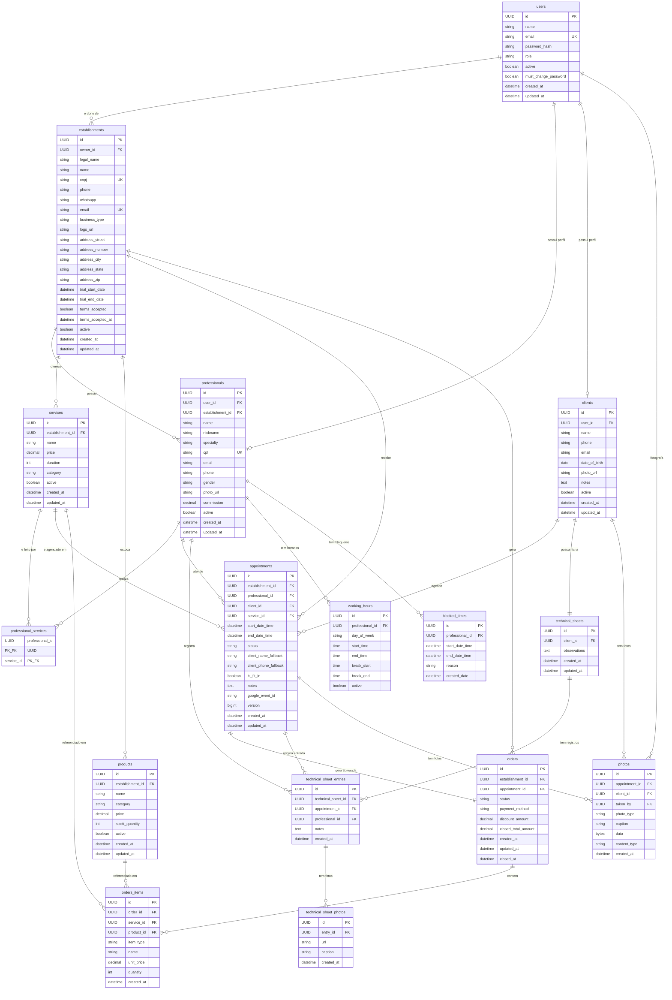

# 🗄️ Modelo de Dados — NextCalendar

Diagrama Entidade-Relacionamento (DER) gerado a partir das entidades JPA do backend.

> **Dica:** O GitHub renderiza este diagrama automaticamente. Para exportar como imagem PNG, abra no [Mermaid Live Editor](https://mermaid.live) e faça o download.

